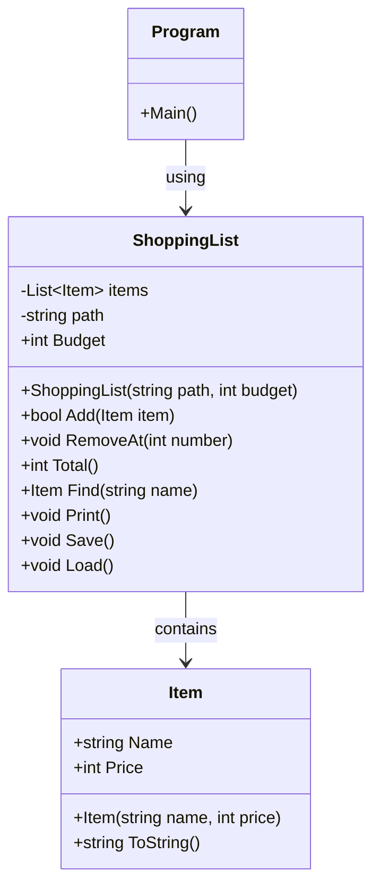

# christoffer-kk2-Improved
# Errors
## Error 1:
Unhandled exception. System.IndexOutOfRangeException: Index was outside the bounds of the array.
   at ShoppingList.Load() in C:\Code\Christoffer-kk2-robust\ShoppingList.cs:line 90
   at Program.<Main>$(String[] args) in C:\Code\Christoffer-kk2-robust\Program.cs:line 2
* Fixed by adding a try catch to the load method in Shoppinglist class..

## Error 2:
If user types a non-number character as price, the program will crash.
* Fixed by adding a tryParse. Also put input price in a whileloop so when prohibited character is used, user will be asked to input price again. 

## Error 3:
Items from file doesnt show their name when printed.
* Fixed by changing split to ReadAllLines in Load-method

## Error 4:
Program crashes when user tries to delete a non-existing item
* Fixed by adding a try catch in program.cs

## Error 5:
Program crashes if user enters a character which is not a choice (1-5)
* Fixed by putting the whole meny under an if-block

## Error 6:
Program crashes if "items.txt" doesnt exist (or has a different namne)
* Fixed by checking if the file exists before it gets loaded. If it doesnt exists, program will create one.

## Error 7:
Calculation of total sum is incorrect. First item doesn't included in calculation.
* Fixed by changing int i = 1 to int i = 0 in Shoppinglist Total-method

## Error 8:
Save-related error. If saving file failed, user did not get en errormessage.
* Fixed by moving "Listan är sparad" to try and changing unspecified catch to specified catches.

# Design choices
Added a fixed budget to shoppinglist class. When trying to add item, the add-method will check the budget and only add an item if the budget allows. Then it will return a boolean to program. Program will, if the returned boolean is false, print a message telling user the item was not added. 
I chose this solution because this way the code allows the user to try to add an item for which he/she can't afford. This is expected to happen and it's not a typing error or such (like trying to a negative number as price). Therefore this shouldnt be under a try catch but instead under a logic which instead chooses what to do if the user can afford it and what to do if he/she can't.

# Class chart

